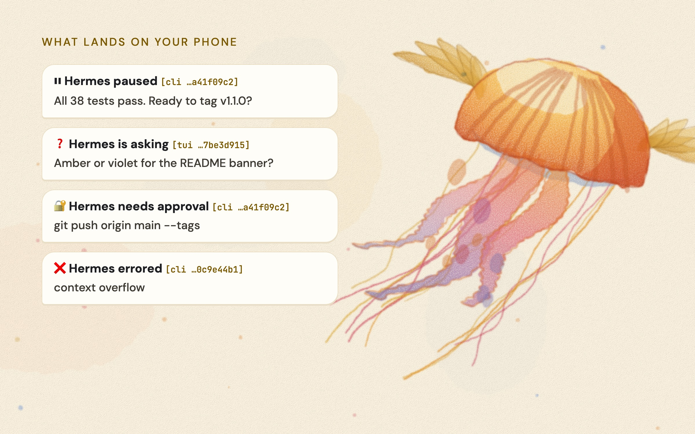
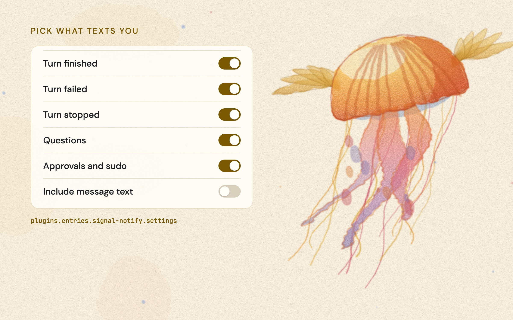

# signal-notify for Hermes Agent


[](https://github.com/dbrosnan/hermes-signal-notify/actions/workflows/ci.yml)
[](https://scorecard.dev/viewer/?uri=github.com/dbrosnan/hermes-signal-notify)
[](LICENSE)
[](https://github.com/NousResearch/hermes-agent)
[](https://hermes-agent.nousresearch.com/docs/plugins/signal-notify)

Get a Signal text when your [Hermes Agent](https://github.com/NousResearch/hermes-agent)
needs you. Hermes texts you when:

| Event | Text |
|---|---|
| A turn finishes and Hermes is waiting for your next message | `⏸ Hermes paused [tui …a1b2c3d4]` plus the start of its reply |
| A turn fails or ends without finishing (an error, the iteration limit) | `❌ Hermes errored [...]` plus the exit reason |
| A turn is interrupted | `⏹ Hermes stopped [...]` plus the reason |
| Hermes asks a `clarify` question | `❓ Hermes is asking [...]` plus the question |
| Hermes needs a command approval or a sudo password | `🔐 Hermes needs approval [...]` or `🔑 Hermes needs a sudo password [...]` plus the command |

Leave a long agent run going, walk away, and your phone tells you when it stops or has a
question.



## Requirements

- Hermes Agent 0.21.5 or newer.
- A running [signal-cli](https://github.com/AsamK/signal-cli) daemon with its HTTP endpoint
  on (`signal-cli daemon --http`), registered to a number Hermes sends from. If you already
  use Hermes' Signal gateway, you have this.
- These variables in `~/.hermes/.env`, which Hermes' Signal gateway also uses:
  - `SIGNAL_HTTP_URL`, for example `http://127.0.0.1:8080`. Use a loopback, private network
    (such as Tailscale) or HTTPS address: text travels to signal-cli as plain HTTP otherwise.
  - `SIGNAL_ACCOUNT`, the number signal-cli is registered to
  - `SIGNAL_HOME_CHANNEL`, the number to text. The `recipient` setting overrides it.

## Quick start

signal-notify is listed in the
[Hermes plugin catalog](https://hermes-agent.nousresearch.com/docs/plugins/signal-notify), so
Hermes installs the reviewed, pinned release:

```bash
hermes plugins install signal-notify
hermes plugins enable signal-notify
```

Later releases reach you with `hermes plugins update signal-notify` once the catalog pin is
bumped.

To run the latest unreleased code from `main` instead, which Hermes marks as unreviewed:

```bash
hermes plugins install https://github.com/dbrosnan/hermes-signal-notify
```

To check it works, ask Hermes anything and let the turn finish. A `⏸ Hermes paused` text
should arrive within a few seconds.

A running gateway picks up the hooks when the plugin is enabled. CLI and TUI sessions pick
them up the next time they start.

## Settings

Each event has its own switch in the Hermes Desktop app under Settings → Plugins →
signal-notify. They live under `plugins.entries.signal-notify.settings` in `config.yaml`,
so you can set them there too.



| Setting | Default | Meaning |
|---|---|---|
| `notify_paused` | on | Text when a turn ends and Hermes is waiting for your next message. |
| `notify_failed` | on | Text when a turn errors out. |
| `notify_interrupted` | on | Text when a turn is interrupted or stopped. |
| `notify_questions` | on | Text when Hermes asks a clarifying question. |
| `notify_approvals` | on | Text when Hermes needs a command approval or a sudo password. |
| `include_text` | on | Add a preview of the reply or prompt. Off sends only the event and session. |
| `reply_chars` | `300` | How many characters of preview to include while `include_text` is on. |
| `recipient` | `""` | Number or UUID to text. Empty uses `SIGNAL_HOME_CHANNEL`. |
| `skip_platforms` | `[signal, cron, subagent]` | Turns from these platforms never text. Signal chats already show the reply, cron jobs have their own delivery, and subagent turns would be noise. |

For example, to hear only about questions and approvals, with no message text:

```yaml
plugins:
  entries:
    signal-notify:
      settings:
        notify_paused: false
        notify_failed: false
        notify_interrupted: false
        include_text: false
```

Upgrading from 1.0? The old `notify_on` list still works for any switch you haven't set, so
nothing changes until you flip one.

Identical texts within 60 seconds are sent once, so a burst of the same prompt does not flood
your phone.

## What it sends and where (disclosure)

- **Network:** each event makes one HTTP POST to the signal-cli endpoint in
  `SIGNAL_HTTP_URL`, in plain HTTP unless that URL is `https://`. signal-cli then sends an end-to-end encrypted Signal message to the
  recipient. Nothing goes to any other service.
- **Conversation text, on by default:** up to `reply_chars` (300) characters of the final
  reply, the clarify question, or the approval or sudo command. Hermes redacts secrets from
  question and command text before the hook sees it. **Reply text is not redacted**, so
  anything the agent wrote in the first 300 characters of its reply reaches your phone. Turn
  off **Include message text** (`include_text: false`) to send no conversation text.
- **Never sent:** sudo passwords and your answers to questions. Hermes does not give either
  to hooks.
- **Credentials:** reads `SIGNAL_HTTP_URL`, `SIGNAL_ACCOUNT` and `SIGNAL_HOME_CHANNEL`
  through Hermes' `secret_scope`. It stores nothing and never reads `.env` itself.
- **Memory:** keeps a preview of at most 64 recent replies, each clipped to `reply_chars`.
- **Background work:** each send runs on a short-lived daemon thread with a 20 second
  timeout, so a slow or offline signal-cli never blocks Hermes. Failures are logged and
  dropped.
- No shell commands, no files written, no telemetry, no self-updates.

The install security scan flags `sudo_usage` as a caution. That comes from the label for
Hermes' sudo prompt. The plugin never runs sudo.

## How it works

Three public Hermes hooks, with no core patching:

- `post_llm_call` keeps the latest reply for each session so the pause text can quote it.
- `on_session_end` fires when every turn finishes and decides whether the turn paused,
  failed or was interrupted.
- `on_human_input_request` fires right before Hermes blocks on a clarify, approval or sudo
  prompt.

## Troubleshooting

| Symptom | Check |
|---|---|
| No texts at all | `hermes plugins list` shows `signal-notify` enabled. `~/.hermes/logs/agent.log` has `signal-notify` lines. |
| Log says `SIGNAL_HTTP_URL, SIGNAL_ACCOUNT or recipient missing` | Set the variables in `~/.hermes/.env` and restart the session or gateway. |
| Log says `send failed` | signal-cli isn't reachable: `curl -X POST $SIGNAL_HTTP_URL/api/v1/rpc -H 'content-type: application/json' -d '{"jsonrpc":"2.0","method":"version","id":1}'` |
| Log says `signal-cli error: ... Unregistered user` | The recipient isn't a Signal user, or the number is missing the `+` country code. |
| Texts from the CLI but not the TUI, or the other way round | Each process loads plugins when it starts. Restart the one that's missing texts. |
| Two texts per event | An old copy of the plugin is still loaded. Restart the gateway with `hermes gateway restart`. |
| Too many texts | Switch off the events you don't need, or add platforms to `skip_platforms`. |

## FAQ

**Can I reply to Hermes from the text?** Not through this plugin, which only sends. Hermes'
own Signal gateway handles two-way chat, and its turns are skipped here so you don't get
each reply twice.

**Does it work with Telegram, Slack or email?** No, it's Signal only. For Telegram, see
[telegram-notify](https://github.com/madpower2000/hermes-telegram-notify).

**Does it slow Hermes down?** No. Each send runs on its own thread with a 20 second
timeout, and the agent never waits for it.

## Artwork

The watercolor jellyfish, a messenger with Hermes' wings, is drawn in code by
[docs/art/make_art.py](docs/art/make_art.py) and rendered with headless Chrome. Run it again
to rebuild every image in `docs/assets/`.

## Contributing

Bug reports, ideas and pull requests are welcome. Start with
[CONTRIBUTING.md](CONTRIBUTING.md), and see [SECURITY.md](SECURITY.md) for private
vulnerability reports. Everyone taking part follows the
[Code of Conduct](CODE_OF_CONDUCT.md). Releases are described in
[docs/RELEASING.md](docs/RELEASING.md), and changes are listed in
[CHANGELOG.md](CHANGELOG.md).

```bash
uvx --with pytest-cov pytest --cov=. tests
uvx ruff check . && uvx ruff format --check .
hermes plugins validate .
```

## License

MIT
